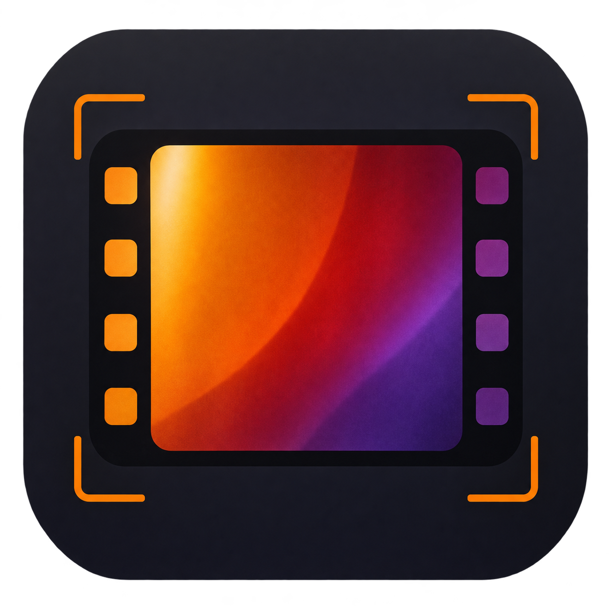

# Film Tools for Capture One



An independent Windows tool that brings the spektrafilm film and print simulation into Capture One. Develop your RAW in Capture One, adjust the film look in a docked or floating panel, and export the result as a 16-bit image.

**Supported host: Capture One 16.4.6.2414 on Windows x64.** You'll also need a GPU and driver that support Vulkan. The launcher checks the exact Capture One build because the panel uses internal interfaces. This build works with catalogs (`.cocatalogdb`). Start with a test catalog when trying the integration.

Capture One provides older installers in your account when your license supports them. [Capture One download guide](https://support.captureone.com/hc/en-us/articles/14996282988957-Download-an-Older-Version-of-Capture-One)

## Install and open

1. Download **Film-Tools-for-Capture-One-v0.1.0-windows-x64.zip** from [GitHub Releases](https://github.com/nothing-complex/film-tools-for-capture-one/releases/latest) and extract it.
2. Run **Install Film Tools.cmd**. It installs into `%LOCALAPPDATA%\Programs\Film Tools for Capture One` and creates the **Capture One with spektrafilm** desktop shortcut. Installation runs under your Windows account without an administrator prompt.
3. Close Capture One. Use the new shortcut and choose the catalog database inside your catalog folder. The launcher backs up the closed database before opening it.
4. Select a photo and open the **Film Tools** tab with the film-strip icon. Allow the Viewer to develop the first frame.

For portable use, run **Start Film Tools.cmd** from the extracted folder and choose a catalog. To use Film Tools again after quitting, start from the shortcut or the launcher. Capture One's usual shortcut starts its usual workspace.

To update Film Tools, close Capture One and run the new release's installer. To verify the download, use `Get-FileHash -Algorithm SHA256` on the ZIP and compare the result with the `.sha256` file on the release page.

## Use the panel

- Turn **Enable Film Tools** on or off. The live look follows the selected photo and stays visible when you switch tool tabs. **Show source** temporarily displays the developed source for comparison.
- Select **Print Simulation** to pair a negative and print stock, or **Scan Film** to work from film alone. Use film exposure, print exposure and look strength to set the overall result. Double-click a slider to restore its default. The number fields accept direct entry.
- Expand the development, print, spectral reconstruction and optics sections for push/pull, dye and filter adjustments, halation, diffusion, scanner effects and grain. **Capture One Grain** applies a native adjustment when you click its Apply button.
- Choose **Float Tool** in the tool's three-dot menu. Close the floating tool to dock it again.
- Use **Viewer resolution** to select native size or a 720–4096 px long-edge cap. **Drag preview resolution** sets the temporary long edge while adjusting sliders. 1200 px is the starting value. Set it to 1600 or 2048 px for more detail, or lower either setting to reduce GPU work. The Viewer returns to its selected quality when the drag settles.
- In the color controls, pick the input working space Capture One develops into. Use sRGB to start, or choose Linear Rec.2020, ProPhoto RGB or Adobe RGB (1998). Film Tools passes that encoding to the renderer. The Viewer accepts sRGB, Rec.709 gamma 2.4 and Linear Rec.709 output choices. File exports are tagged sRGB. RAW development, camera profiles and Capture One adjustments are handled by Capture One.
- Use **Save preset** and **Load preset** in **Presets and LUT export** to retain a look and its controls.

## Saved looks

Film Tools automatically saves every change to the selected Capture One variant, including the enable switch, stocks, sliders, and preview settings. Each change is committed immediately, so Capture One can reopen the last complete save after a crash. Choose the same catalog through the desktop shortcut to restore its saved looks.

Film Tools keeps these files under `%LOCALAPPDATA%\FilmToolsForCaptureOne\Variant looks`. Back up that folder along with your catalog. Saved looks are associated with the catalog's path on this computer. Use **Save preset** to take a look to another catalog or computer.

## Export at 16 bits

With Film Tools enabled, select the photo and one enabled Export Recipe, then open Capture One's **Export** dialog. Confirm the export and choose **16-bit TIFF** or **16-bit PNG** in the Film Tools save dialog. The integration uses recipe sizing and crop where supported. The **Export with Film Tools** button in the panel also offers TIFF or PNG for the selected image. Source development and processing use high-depth channels through the 16-bit output encoder. **Save preview PNG** saves the on-screen comparison frame.

The export path is for the selected image with one recipe. It supports up to 32 megapixels and an 8192 px long edge. Reduce recipe size if the source would exceed those limits. Disable **Enable Film Tools** to export through Capture One alone.

### Optional .cube export

Install 64-bit [Python 3.13](https://www.python.org/downloads/) and run **Setup LUT Export.cmd** in the installed folder. It creates a local environment and downloads the reference runtime's dependencies. Relaunch and choose a 33- or 65-point LUT from **Presets and LUT export**. The LUT uses sRGB input and output and represents the color transform. Keep the attribution in its header if you share it. [Profile and LUT license](upstream-spektrafilm/SPEKTRAFILM_LICENSE.txt)

## Troubleshooting and uninstall

| Symptom | What to do |
| --- | --- |
| Film Tools is missing after restart | Close every Capture One window and launch again through **Capture One with spektrafilm**. Open the catalog selected at launch. |
| Launcher reports a version mismatch | Select the x64 Capture One 16.4.6.2414 installation. |
| Viewer is slow | Select a smaller Viewer and drag-preview resolution. Lower the grain synthesis sample count if you are using synthesis. |
| Launcher finds an open or busy catalog | Open it in Capture One normally, close it, and retry. |
| GPU or startup error | Run `.\Start-FilmTools.ps1 -CheckOnly` in PowerShell from the installed folder. It checks the release files, Capture One build and a Vulkan test frame. |

Diagnostic logs and up to five database backups per catalog are under `%LOCALAPPDATA%\FilmToolsForCaptureOne`. The database backup covers the catalog database file. Keep your normal catalog and image backups as well.

To uninstall, close Capture One, delete the **Capture One with spektrafilm** desktop shortcut, and remove the installed **Film Tools for Capture One** folder. Catalog backups can be retained separately. If you used portable mode, remove the extracted folder.

## Build from source

Building requires Windows x64, Visual Studio 2022 with Desktop development with C++, CMake 3.24 or newer, a Vulkan SDK, the .NET 8 SDK, 64-bit Python 3.13 and a local installation of Capture One 16.4.6.2414. The checked-in upstream snapshots contain the code and tables used in the build. From the repository in PowerShell, point `$python` to your Python 3.13 executable and run:

```powershell
& $python -m pip install -r .\requirements-build.txt
.\Build-Windows.ps1 -BuildPanel -StageRuntime -PythonPath $python
.\Start-FilmTools.ps1 -CheckOnly
.\Package-Windows.ps1 -Version 0.1.0
```

Use `-VulkanSdkPath` to specify a Vulkan SDK location or `-CaptureOneDirectory` for a custom Capture One installation. The build runs the renderer smoke test by default. Packaging writes the archive and SHA-256 checksum to `dist`. See the [upstream build and changes](UPSTREAM-CHANGES.md) and [third-party notices](THIRD-PARTY.md).

## Credits

Andrea Volpato created the original spectral simulation and built the film profiles from real sensitometry and dye data. Aedan Diez built the Vulkan-powered OFX port that makes it practical to use the engine interactively. Both projects are worth exploring. [Andrea's spektrafilm](https://github.com/andreavolpato/spektrafilm) · [Aedan's spektrafilm OFX](https://spektrafilm.114c.de/)

Capture One integration by [Luka Kauzlaric](https://www.lukakauzlaric.com). I'm also building [Lensflare](https://www.lensflare.io).

Film Tools is distributed under the [GNU GPL v3](LICENSE). Film profiles and direct derivatives have separate CC BY-SA 4.0 terms. Film Tools is an unofficial integration developed independently of Capture One and the upstream authors.
